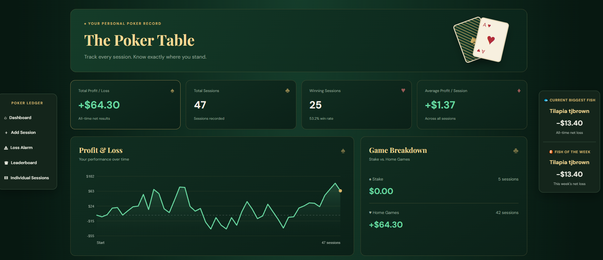
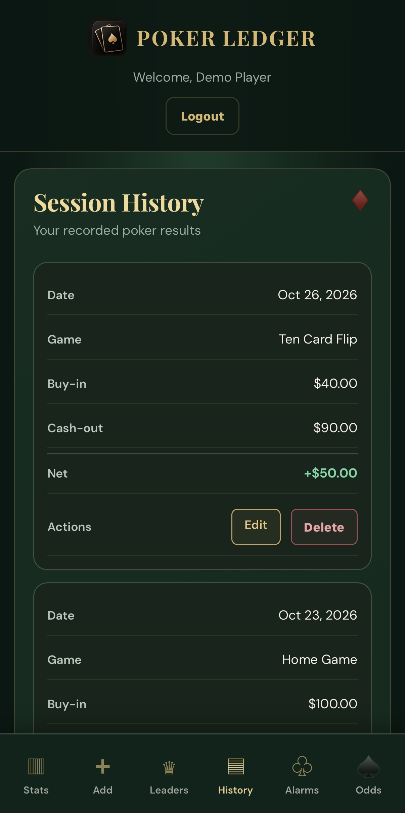
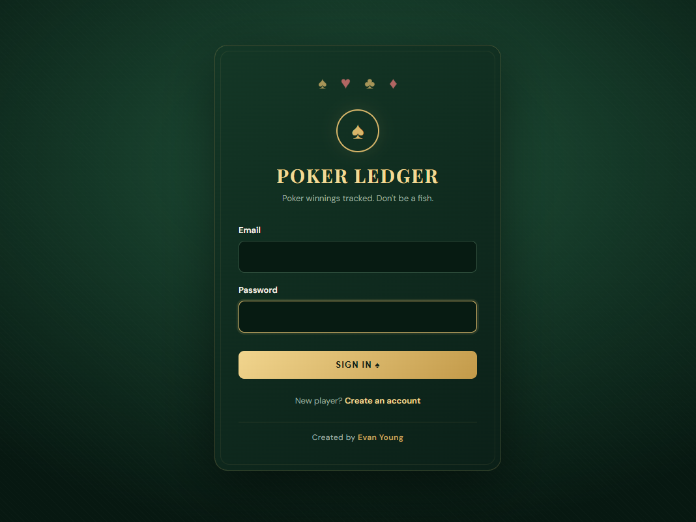

# ♠ Poker Ledger

Poker Ledger is a full-stack web application for tracking poker sessions, analyzing financial performance, and promoting responsible gambling awareness through customizable loss-limit alerts.

Built with Python and Flask, the application provides a responsive experience for desktop and mobile users, combining session management, performance analytics, leaderboards, and poker reference tools.

## Screenshots

### Desktop Dashboard

Track session history, profits and losses, performance trends, and personal loss limits.

### Mobile Dashboard

A mobile-friendly interface with streamlined navigation and access to session tracking, statistics, and leaderboards.

### Login Page

Account authentication provides access to personalized session records and statistics.

## Features

- **Session Management:** Add, edit, and delete poker sessions, including game type, buy-ins, cash-outs, and notes.
- **Performance Analytics:** Track net profit and loss, review historical performance, and visualize trends through interactive charts.
- **Leaderboards:** Compare player results across different time periods, including Biggest Fish and Fish of the Week awards.
- **Loss-Limit Alerts:** Configure personal loss thresholds and receive warnings to encourage responsible gambling awareness.
- **Poker Charts & Odds:** Access Texas Hold'em starting-hand ranges, draw odds, pot odds calculations, and hand rankings.
- **Game Support:** Track multiple poker game types, including Ten Card Flip, with a dedicated reference section.
- **Account Management:** User registration, authentication, and personalized dashboards.
- **Admin Dashboard:** Role-restricted tools for managing user accounts and session records.
- **Responsive Interface:** Desktop and mobile layouts with dedicated navigation and installable web-app support.

## Tech Stack

| Category | Technologies |
|---|---|
| Backend | Python, Flask, SQLAlchemy |
| Frontend | HTML, CSS, JavaScript |
| Database | SQLite |
| Authentication & Security | Flask-Login, Argon2, CSRF protection, rate limiting |
| Deployment | AWS EC2, Gunicorn, Nginx, HTTPS |

## Project Purpose

Poker Ledger was developed as a practical full-stack project demonstrating web application development, database management, authentication, access controls, responsive design, and data visualization.

A key focus is **responsible gambling awareness**. By providing detailed financial tracking and configurable loss-limit alerts, the application helps users recognize spending patterns and make more informed decisions.

The project also demonstrates experience building, securing, and maintaining a deployed web application.

## Disclaimer

Poker Ledger is intended for personal financial tracking, educational reference, and gambling awareness. It does not facilitate gambling, guarantee financial outcomes, or replace professional support for gambling-related problems.
